<div align="center">


</div>

<br/>

## Quem sou.

Gosto de chegar num processo bagunçado, entender por que ele é do jeito que é e deixá-lo mais simples.
Depois eu construo o que faltava: o indicador que mostra onde agir, a consulta SQL que busca o dado direto na fonte e a automação que tira o trabalho manual da frente de todo mundo.

Venho da indústria, moro no interior de São Paulo e hoje vivo entre **processo, dado e automação**.
Quando alguém pergunta "isso dá pra automatizar?", respondo com outra pergunta: o processo está certo antes?

<br/>

## Como eu trabalho.



Sou Lean Six Sigma Master Black Belt, então mapeio, meço e procuro onde está a variação antes de automatizar.
Uso IA para prototipar mais rápido, mas tudo que eu entrego passa por validação, backup e registro de execução.
E quando um resultado não vem como esperado, eu mostro. Transparência também faz parte da análise.

<br/>

## Números que importam.


Também evitei uma contratação externa (economia estimada de R$ 200 mil) ao construir por conta própria a solução de indicadores em Power BI, e fui usuário-chave numa certificação de qualidade automotiva que abriu as portas de uma montadora como cliente.

<br/>

## Código, simulado.

Exemplos fictícios, só para mostrar como eu penso.


<details>
<summary><b>SQL.</b> Primeiro eu ataco o que mais dói.</summary>

```sql
SELECT   processo,
         COUNT(*)                                          AS ocorrencias,
         ROUND(AVG(tempo_manual_min), 1)                   AS minutos_perdidos,
         ROUND(100 * RATIO_TO_REPORT(COUNT(*)) OVER (), 1) AS pct_do_total
FROM     operacao_simulada
WHERE    status = 'RETRABALHO'
GROUP BY processo
ORDER BY ocorrencias DESC
FETCH FIRST 5 ROWS ONLY;
```

</details>

<details>
<summary><b>DAX.</b> Mostrar o desvio, não só o número.</summary>

```dax
Desvio vs Meta % =
VAR Realizado = [Total Realizado]
VAR Meta      = [Total Meta]
RETURN
    IF ( Meta = 0, BLANK (), DIVIDE ( Realizado - Meta, Meta ) )
```

</details>

<details>
<summary><b>PowerShell.</b> Validar, fazer backup, registrar.</summary>

```powershell
function Invoke-AutomacaoSegura {
    param([string]$Origem, [string]$Destino)

    Copy-Item $Destino "$Destino.bak" -Force                        # 1. backup antes de mexer
    $dados = Import-Csv $Origem

    if ($dados.Count -eq 0) { throw "Origem vazia, abortando." }    # 2. validação

    $dados | Export-Csv $Destino -NoTypeInformation
    Add-Content "execucoes.log" "$(Get-Date -f s) OK $($dados.Count) linhas"   # 3. registro
}
```

</details>

<br/>

## Ferramentas.

| | |
|---|---|
| **Dados** | SQL (Oracle), Power BI, DAX, Power Query, Excel avançado |
| **Automação** | Power Automate, Power Apps, SharePoint, PowerShell |
| **Processo** | Lean Six Sigma Master Black Belt, DMAIC, PDCA, Kaizen, KPIs |
| **Sistemas** | SAP, ERP Protheus |

<br/>

## Projetos públicos.

**[SteelFlow AI](https://github.com/bryanleme/steelFlow-ai).** Ambiente para comparar cenários "e se?" de processo industrial, com faixas P10/P50/P90. Mostra inclusive o resultado que não bateu a meta.

**[Achei!! Vagas](https://github.com/bryanleme/achei-vagas).** Monitor automatizado de vagas que roda no GitHub Actions e avisa no Telegram.

<br/>

## Em números.

<div align="center">


</div>

<br/>

## Contato.

Aberto a conversas sobre vagas que unam **processos, operações e dados**.

[LinkedIn](https://www.linkedin.com/in/bryan-leme)
